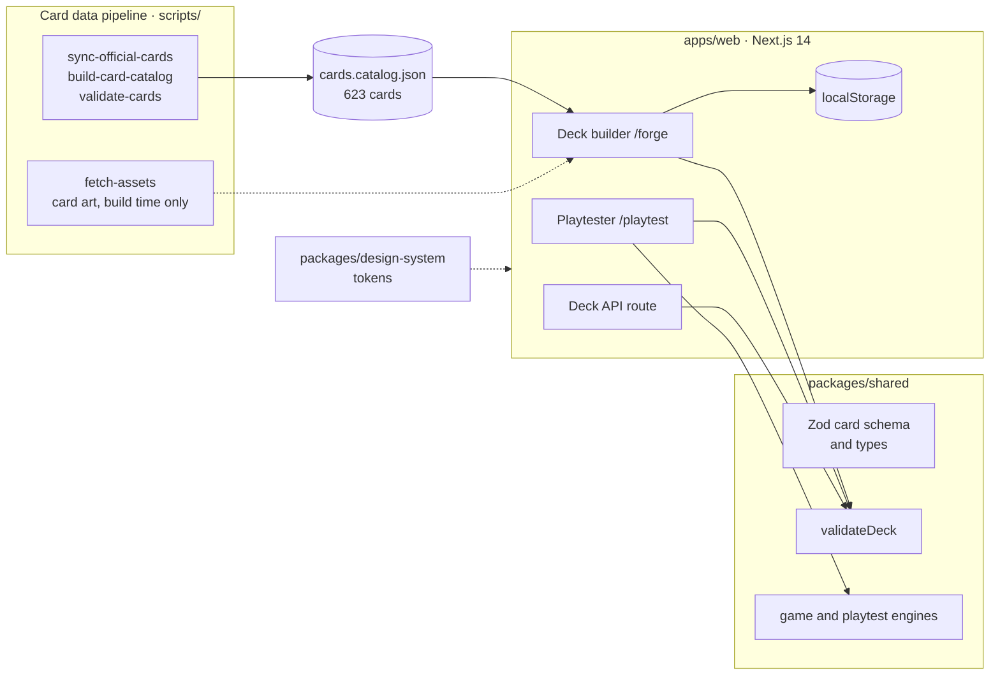

# 3. Architecture

[← Design](02-design.md) · Next: [Key decisions →](04-decisions.md)

## System at a glance

## Monorepo layout

| Package | What's in it | Status |
|---|---|---|
| `apps/web` | Next.js 14 App Router, Radix primitives, TanStack Query, Tailwind. Builds as a static export for GitHub Pages. | Built |
| `packages/shared` | The Zod card schema, `validateDeck()`, the game and playtest engines, and their tests | Built |
| `packages/design-system` | Tokens for colour, spacing, type, motion and card sizes | Partial: the app renders from `globals.css`, not these tokens |
| `packages/data-sync` | Card-data sync tooling | Built |
| `scripts/` | Catalog sync, audit and asset scripts | Built |

## One rules engine, four callers

The most important architectural choice: **the rules live in one function in a shared package**, and everything that cares about deck legality calls it.

- `apps/web/app/forge/forge-workbench.tsx`: the deck builder, on every change
- `apps/web/lib/game/deck-validation.ts`: the playtester's gate
- `apps/web/app/api/decks/route.ts`: the deck API route
- `apps/web/lib/game/deck-loader.ts`: the game's deck loader

`validateDeck()` returns `{ isValid, errors, warnings, metrics }`, and `isValid` depends on errors only. That separation is what lets the interface show advice without blocking anyone (see [Design](02-design.md#designing-the-decision)).

| Kind | Check |
|---|---|
| Rule | Main deck has exactly 50 cards |
| Rule | Resource deck has exactly 10 cards when included (game rule 6-1-1) |
| Rule | At most 2 colours, Colorless excluded (6-1-1-2) |
| Rule | Every card ID exists in the catalog |
| Rule | At most 4 copies of a card (2-1-2) |
| Advice | Consider at least 15 Unit cards |
| Advice | No Resource cards: the simulator will stand in placeholders |
| Advice | Average cost above 4.5: consider cheaper cards |

## Card data

- Sync and audit scripts build `apps/web/public/data/cards.catalog.json` (623 records) from the official card list.
- A shared card classification (PR #8) is used by the filters, the counts and the validator, so they can't disagree about which card is which.
- **Card art** is downloaded by `npm run fetch-assets` into a gitignored folder, locally and in the deploy workflow, and is served from the app's own origin. The image sources block hotlinking, which is why the art isn't loaded straight from them at runtime (`258720a`). If an image is missing, `CardArtImage` falls back to a generated placeholder.

## Persistence

Decks are saved in the browser (`lib/deck/storage.ts`), with a notice where decks are created saying that clearing browser data deletes them. Accounts, cloud deck sync and favourites exist as Supabase paths behind feature flags (`lib/config/features.ts`) that are off by default.

## Deployment

`.github/workflows/deploy.yml` runs on every push to `main`: lint, type-check and build, fetch card art, then a static export to GitHub Pages with the `/Gundam-Forge` base path, plus a check of the exported files.
